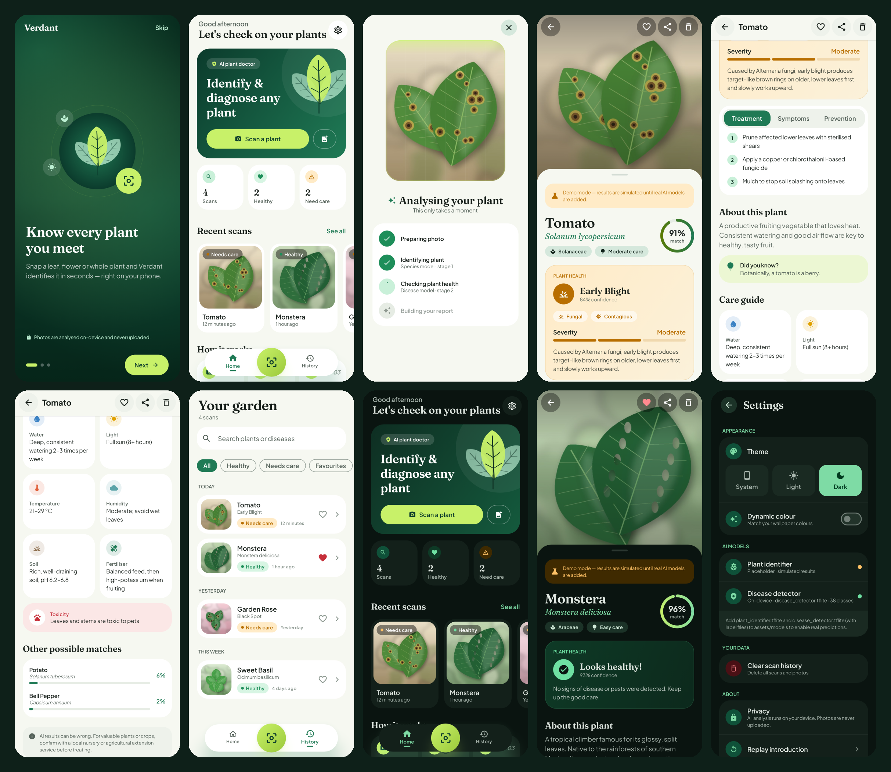

# Verdant: AI plant identification & disease detection (Android)

A modern Android app written in Kotlin and Jetpack Compose. You photograph a plant, then two
on-device AI models run one after the other:

1. **Plant identification:** which species is it?
2. **Disease detection:** is it healthy? If not, what's wrong, how serious is it, and how do you treat it?

Both models are **placeholders for now**. Drop in `.tflite` files and the app switches to them
automatically (see [docs/MODELS.md](docs/MODELS.md)).



## Features

- **Camera scanning** (CameraX): framing guide, animated scan line, flash (off/auto/on), front/back switch,
  tap-to-focus, pinch-to-zoom, haptics.
- **Gallery import** through the system Photo Picker (no storage permission needed).
- **Two-stage analysis screen** that shows live progress for each stage.
- **Rich results:** confidence ring, health card (healthy / possible / diseased with severity meter,
  pathogen type, contagious flag), tabbed Treatment / Symptoms / Prevention, care guide
  (water, light, temperature, humidity, soil, fertiliser), toxicity warning, other likely matches,
  and a disclaimer.
- **History ("Your garden"):** search, filters (healthy / needs care / favourites), date groups,
  swipe to delete with undo, favourites.
- **Home dashboard:** stats, recent scans, how-it-works, tip of the day.
- **Onboarding**, **Settings** (light/dark/system theme, Material You dynamic colour, model status,
  clear history, replay intro), **splash screen**, adaptive and themed launcher icon.
- **Private by design:** everything runs on the device; photos are never uploaded.

## Edge cases handled

| Situation | Behaviour |
|---|---|
| Camera permission denied / permanently denied | Explains why it's needed, offers *Open settings*, always offers gallery instead |
| No camera / no flash / no front camera | Matching controls are hidden; gallery still works |
| Photo isn't a plant, too dark or blurry | Low confidence or a `background` class → "We couldn't find a plant" plus tips; nothing is saved |
| Disease model fails | Plant result is kept, health shown as "unavailable" |
| Plant model or storage fails | Clear error, retry, and the temporary file is cleaned up |
| Unreadable or unsupported image | Friendly error, prompt to pick another photo |
| Low-confidence disease | Shown as "Possible ..." |
| Label with no knowledge-base entry | Prettified name with a "details unavailable" note |
| EXIF rotation, huge photos | Turned upright and downscaled to 1600 px before saving |
| Back pressed during analysis | Analysis cancelled, files cleaned up |
| Process death mid-analysis | Saved state prevents duplicate scans |
| Crashes leaving stray files | Orphaned photos swept on next launch |
| Deleting by mistake | Undo snackbar in history; confirmation dialog on the result screen |

## Architecture

```
UI (Compose screens + ViewModels, StateFlow)
        │
domain/AnalyzePlantUseCase  ── the pipeline: import → identify → diagnose → save
        │
 ┌──────┼───────────────────────────┐
 ml/                                data/
 ├ PlantIdentifier  (interface)     ├ knowledge/  JSON knowledge base (labels → content)
 ├ DiseaseDetector  (interface)     ├ local/      Room database (scans)
 ├ tflite/          real models     ├ image/      photo storage (EXIF, downscale)
 └ placeholder/     simulated       ├ preferences DataStore (theme, onboarding)
                                    └ repository/ ScanRepository
```

- **MVVM** with unidirectional state, **Hilt** for DI, **Room**, **DataStore**, **Navigation Compose**
  with type-safe routes, **Coil** for images, **TensorFlow Lite** for inference.
- Each screen is split into a ViewModel-backed wrapper and a stateless `...Content` composable,
  so previews and screenshot tests are easy.
- Model and label strings are stored raw in the database and resolved at read time, so
  improving the knowledge base updates old scans too.

```
app/src/main/java/com/verdant/app/
├── data/        knowledge, local (Room), image, preferences, repository, model
├── di/          AppModule, MlModule (real vs placeholder switch)
├── domain/      AnalyzePlantUseCase
├── ml/          contracts, ModelConfig, LabelUtils, ImagePreprocessor, tflite/, placeholder/
├── ui/          theme, components, navigation, onboarding, home, camera, analysis, result, history, settings
└── util/        formatters
```

## Design system

- Palette: deep forest green, leaf green and a lime accent, with full light and dark schemes
  plus extended status colours (healthy / warning / danger).
- Type: **Fraunces** (editorial serif for headlines) with **Plus Jakarta Sans** (UI and body),
  bundled under the SIL Open Font License.
- Large rounded shapes, a floating pill navigation bar with a raised scan button, parallax
  photo header, animated canvas illustrations, edge-to-edge layout.
- Accessibility: content descriptions, live region for analysis progress, semantic headings,
  48dp touch targets, and every string in `strings.xml`, ready for translation.

## Build & run

Requirements: Android Studio Ladybug or newer (or the command line), JDK 17+, Android SDK 35.

```bash
./gradlew assembleDebug            # APK in app/build/outputs/apk/debug/
./gradlew installDebug             # install on a connected device
./gradlew testDebugUnitTest        # unit tests
./gradlew lintDebug                # Android lint
```

minSdk 26 (Android 8.0), targetSdk 35.

### Screenshot tests (Paparazzi)

These are opt-in because Paparazzi replaces `android.jar` on the test classpath:

```bash
./gradlew recordPaparazziDebug -Pscreenshots   # writes app/src/test/snapshots/images
./gradlew verifyPaparazziDebug -Pscreenshots   # fails on visual changes
```

## Tests

- `LabelUtilsTest`: label normalisation, PlantVillage parsing, softmax, top-k.
- `KnowledgeBaseTest`: lookups against the real JSON, plus data-integrity checks.
- `AnalyzePlantUseCaseTest`: the full pipeline, including no-plant, model failures, storage
  failure, file clean-up, demo flag and stage order.
- `ScreenshotTest` / `ResultFullPageTest`: every screen in light and dark.

## Next steps

- Plug in real models ([docs/MODELS.md](docs/MODELS.md)).
- Optional: ABI splits or an App Bundle to cut APK size (most of it is TFLite native libraries).
- Optional: GPU delegate, multi-photo scans, care reminders, cloud backup.
